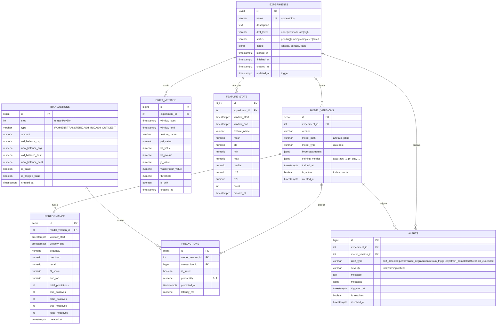

# Modelagem do banco de dados

Esquema PostgreSQL 15 da plataforma, definido em [`backend/db/schema.sql`](../backend/db/schema.sql)
(init do container) e em [`backend/db/models.py`](../backend/db/models.py) (ORM SQLAlchemy).
As migrations Alembic ficam em [`backend/db/migrations`](../backend/db/migrations).

## Diagrama ER



### Regras de integridade

| Regra | Implementação |
| ----- | ------------- |
| Exclusão de experimento remove dependentes | `ON DELETE CASCADE` em todas as FKs para `experiments` |
| Exclusão de modelo remove predições e métricas | `ON DELETE CASCADE` em `predictions` e `performance` |
| `drift_level` e `status` válidos | `CHECK` constraints nomeadas |
| `probability` entre 0 e 1 | `CHECK ck_predictions_probability` |
| Janelas coerentes | `CHECK window_end > window_start` |
| Apenas um modelo ativo por experimento | trigger `trg_deactivate_previous_models` |
| `updated_at` automático | trigger `update_experiments_updated_at` |

### Índices

| Índice | Tabela | Objetivo |
| ------ | ------ | -------- |
| `idx_experiments_status`, `idx_experiments_drift_level` | experiments | filtros do dashboard |
| `idx_model_versions_experiment` | model_versions | versões por experimento |
| `idx_model_versions_active` (parcial) | model_versions | busca do modelo ativo |
| `idx_transactions_step`, `idx_transactions_type` | transactions | janelas temporais |
| `idx_transactions_is_fraud` (parcial) | transactions | taxa de fraude |
| `idx_predictions_model`, `idx_predictions_transaction`, `idx_predictions_predicted_at` | predictions | auditoria e séries |
| `idx_performance_model`, `idx_performance_window` | performance | séries de F1/AUC |
| `idx_drift_experiment`, `idx_drift_feature`, `idx_drift_window`, `idx_drift_experiment_feature` | drift_metrics | consultas do endpoint de drift |
| `idx_alerts_experiment`, `idx_alerts_type`, `idx_alerts_severity`, `idx_alerts_triggered_at` | alerts | painel de alertas |
| `idx_feature_stats_experiment`, `idx_feature_stats_feature`, `idx_feature_stats_window` | feature_stats | estatísticas descritivas |

### Views auxiliares

- `v_drift_summary` — métricas de drift por experimento/feature/janela.
- `v_performance_summary` — médias e extremos de F1 por versão de modelo.

## Migrations (Alembic)

```bash
cd backend

alembic upgrade head       # aplica o esquema (idempotente com schema.sql)
alembic current            # revisão aplicada
alembic history            # histórico
alembic upgrade head --sql # SQL gerado, sem conectar
alembic revision --autogenerate -m "nova coluna"
alembic downgrade -1
```

A revisão inicial (`0001_initial`) cria as oito tabelas a partir do metadata do ORM e, em seguida,
as duas funções PL/pgSQL, os dois triggers (`updated_at` e modelo ativo único) e as duas views
(`v_drift_summary`, `v_performance_summary`) — o mesmo conjunto do `schema.sql`. Como usa
`checkfirst=True` e `CREATE OR REPLACE`, rodar sobre um banco já inicializado pelo `schema.sql`
apenas registra a versão em `alembic_version`.

## Volumetria e retenção

- `transactions` e `predictions` crescem por transação: particionar por `step`/`predicted_at` ou
  arquivar janelas antigas após o experimento.
- `drift_metrics` cresce por `features × janelas`: manter índices compostos
  `(experiment_id, window_start)` e reter apenas o horizonte de análise.
- `performance` e `feature_stats` são séries curtas (uma linha por janela).
- `alerts` deve ser retido para auditoria; usar `is_resolved` nas consultas do dashboard.

## Backup

```bash
docker-compose exec db pg_dump -U admin -d drift_monitor -Fc > backup.dump
docker-compose exec -T db pg_restore -U admin -d drift_monitor --clean < backup.dump
```
