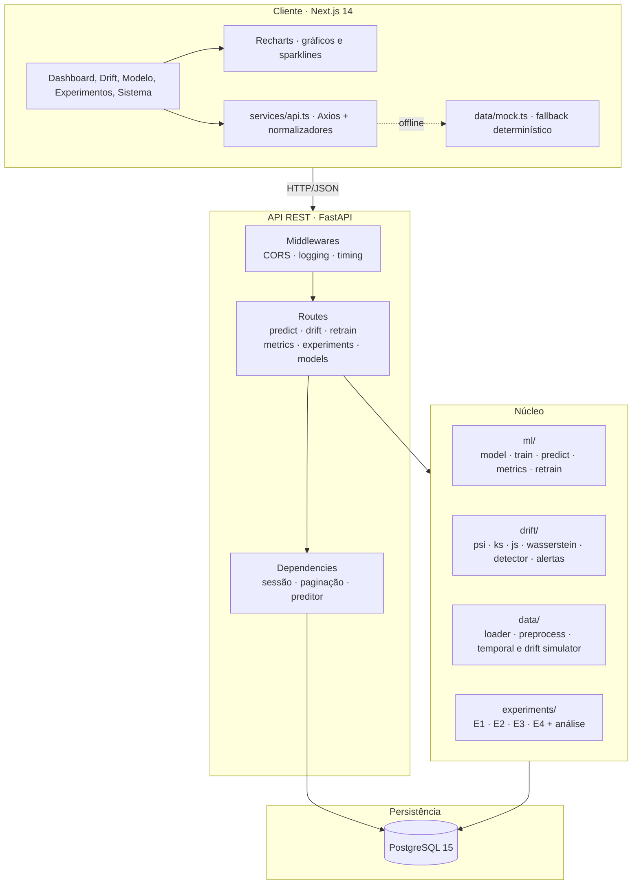
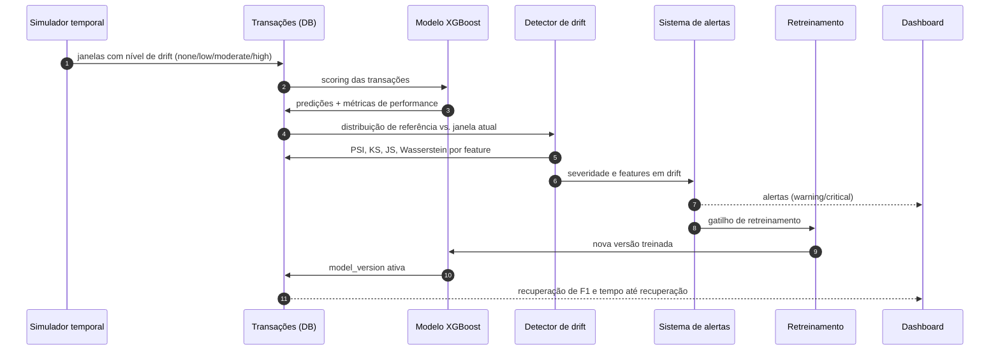

# Visão geral da arquitetura

A plataforma simula um ambiente de fintech para estudar o impacto do Data Drift em modelos de
detecção de fraude. É composta por cinco blocos: modelo de ML, simulador temporal, detecção
estatística de drift, dashboard e retreinamento orientado por alertas.

## Camadas

## Fluxo do experimento

## Responsabilidades por persona

| Persona | Módulos | Entregas |
| ------- | ------- | -------- |
| **Pessoa 1 · ML & Dados** | `ml/`, `data/`, `experiments/e1`, `e2`, `e4` | Dataset, baseline XGBoost, simuladores, métricas, retreinamento |
| **Pessoa 2 · Drift & Estatística** | `drift/`, `experiments/e3`, `statistical_analysis` | PSI/KS/JS/Wasserstein, limiares, alertas, análise estatística |
| **Pessoa 3 · Software & Fullstack** | `api/`, `db/`, `frontend/`, `docker-compose.yml`, docs | API REST, banco + migrations, dashboard, containerização, documentação |

## Decisões de projeto

- **Offline-first no dashboard**: a API é a fonte de verdade, mas o frontend mantém uma base
  determinística com o mesmo contrato de tipos; o estado da conexão é sempre visível.
- **Detecção sem banco**: `/api/v1/drift/detect/feature` permite calcular os quatro métodos a partir
  de valores brutos, o que viabiliza o sandbox da Pessoa 2 e testes rápidos.
- **Preditor heurístico**: sem artefato treinado, a API responde com probabilidade determinística
  (`mode: mock`), mantendo o produto demonstrável antes do pipeline de ML. Com o artefato
  versionado (`v1.1.0-xgb`), o mesmo contrato passa a `mode: model`.
- **Pipeline de ML reprodutível**: XGBoost com fallback para scikit-learn; PaySim real quando
  disponível ou gerador sintético determinístico com o mesmo contrato. Treino e inferência
  compartilham as 9 features de `data/preprocess.py`.
- **Retreinamento por alerta**: a nova versão entra em produção imediatamente após o treino,
  com limiar recalibrado na validação temporal; o E4 mede o ganho de F1 ao longo das janelas.
- **Modo degradado em desenvolvimento**: sem PostgreSQL e com `DEBUG=true`, a API sobe e expõe
  `/ping`, `/health`, limiares de drift e detecção a partir de valores brutos; endpoints com
  persistência respondem `503 DatabaseUnavailable`. Em produção (`DEBUG=false`) o startup falha
  imediatamente.
- **Migrations idempotentes**: `alembic upgrade head` converge com o `schema.sql` usado pelo
  container, sem exigir banco limpo.
- **Contrato único**: os schemas Pydantic e os tipos TypeScript descrevem as mesmas entidades;
  normalizadores no cliente absorvem `snake_case` da API.

## Documentos relacionados

- [`estrutura_API.md`](estrutura_API.md) — referência dos endpoints
- [`pipeline_ml.md`](pipeline_ml.md) — dataset, features, modelo, experimentos E1/E2/E4
- [`modelagem_banco.md`](modelagem_banco.md) — ER, índices e migrations
- [`metodos_drift.md`](metodos_drift.md) — PSI, KS, JS e Wasserstein
- [`relatorio_E3.md`](relatorio_E3.md) — comparação de sensibilidade
- [`fluxo_trabalho.md`](fluxo_trabalho.md) — divisão de tarefas
